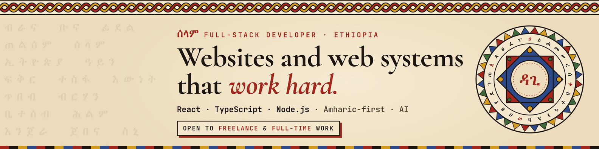
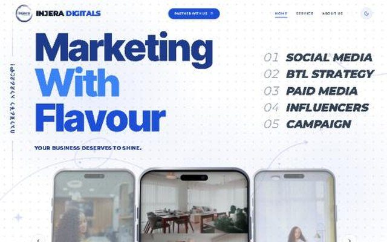
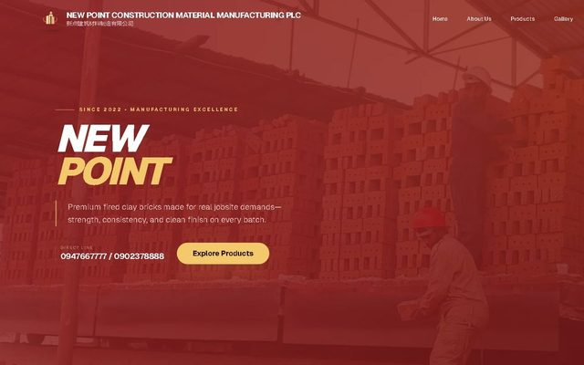
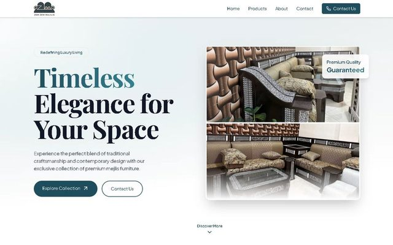
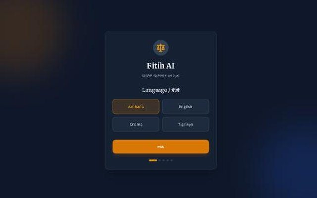
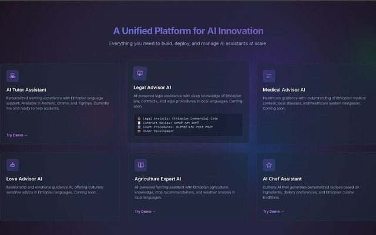

<a href="https://dagixd.dev">
  <picture>
    <source media="(prefers-color-scheme: dark)" srcset="assets/banner-dark.png">
    
  </picture>
</a>

### ሰላም, I'm Dagi

I'm Dagim Daniel, a full-stack developer in Addis Ababa. I make websites that are
fun to use and serious about working, and systems that run in production: the
design, the front end, the back end and the deploy. Amharic first when it matters.

- **In production:** a records and reporting system for a branch office in Addis Ababa, built end to end. 841 automated tests, four languages, on a server in Ethiopia.
- **Built for the languages we speak:** Amharic-first interfaces, typing Ge'ez on computers with no Amharic keyboard, the Ethiopian calendar, and AI that answers in Afaan Oromoo and Tigrinya.
- **Behind it:** a B.Sc. in Electrical and Computer Engineering, a degree in Business Management and Entrepreneurship, and ALX Software Engineering.
- **Open to** freelance and full-time work, in English or Amharic. Addis Ababa is UTC+3 all year.

## Live, for clients

Most of this code lives in private repositories, so here is where it runs.

<table>
  <tr>
    <td width="50%" valign="top">
      
       <b>Office Record System</b> · 2026
       Six departments of a branch office file plans, reports and figures against the Ethiopian budget year; the office reviews and rates them, and a public page shows what it publishes. In Amharic, English, Afaan Oromoo and ትግርኛ.
       React 19 · Express 5 · Prisma · MySQL · Redis · Meilisearch · Docker · Caddy
       <a href="https://nslkworeda11office.com/">nslkworeda11office.com</a>
    </td>
    <td width="50%" valign="top">
      
       <b>Injera Digitals</b> · 2026
       The website of a Gen Z-led marketing agency, built around a campaign simulator: drag a budget and a length, pick TikTok, Telegram or Meta, watch the forecast redraw, and send the plan as an inquiry.
       TypeScript · React · Vite · Tailwind
       <a href="https://injeradigitals.com">injeradigitals.com</a>
    </td>
  </tr>
  <tr>
    <td width="50%" valign="top">
      
       <b>New Point Construction</b> · 2026
       For a clay-brick manufacturer near Menagesha: a bold first screen with the direct phone line on it, then the product range, the factory, a gallery and the team. With SEO.
       TypeScript · React · Vite
       <a href="https://newpointconstructions.com">newpointconstructions.com</a>
    </td>
    <td width="50%" valign="top">
      
       <b>ZemZem</b> · 2025
       A showroom for Zemzem Mejlis and Furniture: mejlis sets, cushions and dining sets in interactive galleries.
       React · TypeScript · Tailwind · Framer Motion
       <a href="https://zem-zem.vercel.app">zem-zem.vercel.app</a>
    </td>
  </tr>
</table>

Before these: [Bekur Architects](https://bekur.vercel.app), my first deploy, and
JMN Global News, a news platform with a digital library in several languages, on the MERN stack.

## AI, in the languages we speak

Demos asking what AI looks like in Amharic, Afaan Oromoo and Tigrinya, not just
English. Built to explore the idea, on the Gemini API.

<table>
  <tr>
    <td width="33%" valign="top">
      
       <b>Fitih AI</b>
       ፍትሕ means justice. A legal assistant that starts by asking which language you speak.
       <a href="https://fitih-ai-v1-0.vercel.app">try the demo</a>
    </td>
    <td width="33%" valign="top">
      
       <b>Tutor AI</b>
       An Ethiopian learning companion that meets you in your language.
       <a href="https://tutor-ai-v2.vercel.app">try the demo</a>
    </td>
    <td width="33%" valign="top">
      
       <b>Addis AI</b>
       One home for assistants in local languages: a tutor, an agriculture expert, a chef.
       <a href="https://addis-ai-2.vercel.app">try the demo</a>
    </td>
  </tr>
</table>

## What I build with

And the parts with no logo: Amharic-first interfaces, Ethiopian calendar maths,
accessibility, auth (argon2, JWT, 2FA), job queues, Socket.io and Telegram bots,
React Native, the Gemini and OpenAI APIs, and testing with Vitest and Supertest.

## Where it started

A Compaq Deskpro I opened before I understood it, then C++ from a book in the
school library. Then [ALX](https://www.alxafrica.com/), where everything changed. Those repositories are public:

- **C:** [low-level programming](https://github.com/dagi420/alx-low_level_programming), and in pairs, our own [printf](https://github.com/dagi420/printf), a [Monty](https://github.com/dagi420/monty) bytecode interpreter, [binary trees](https://github.com/dagi420/binary_trees) and [sorting algorithms](https://github.com/dagi420/sorting_algorithms)
- **Python & SQL:** [higher-level programming](https://github.com/dagi420/alx-higher_level_programming) and [interview algorithms](https://github.com/dagi420/alx-interview)
- **One app, four times:** the AirBnB clone [v1](https://github.com/dagi420/AirBnB_clone), [v2](https://github.com/dagi420/AirBnB_clone_v2), [v3](https://github.com/dagi420/AirBnB_clone_v3), [v4](https://github.com/dagi420/AirBnB_clone_v4)
- **Servers by hand:** [system engineering & DevOps](https://github.com/dagi420/alx-system_engineering-devops)
- **Front end:** [HTML & CSS](https://github.com/dagi420/alx-frontend), [ES6](https://github.com/dagi420/alx-frontend-javascript), [React & Redux](https://github.com/dagi420/alx-react)

---

My portfolio, [ብራና OS](https://dagixd.dev), is a small operating system on parchment,
drawn in the style of Ethiopian ጠልሰም art. Twelve secrets are hidden in it, one for
each month of the Ethiopian year. Find all twelve and the thirteenth arrives by itself.

Off the clock: chess, as [Bishop5656](https://www.chess.com/member/Bishop5656).
